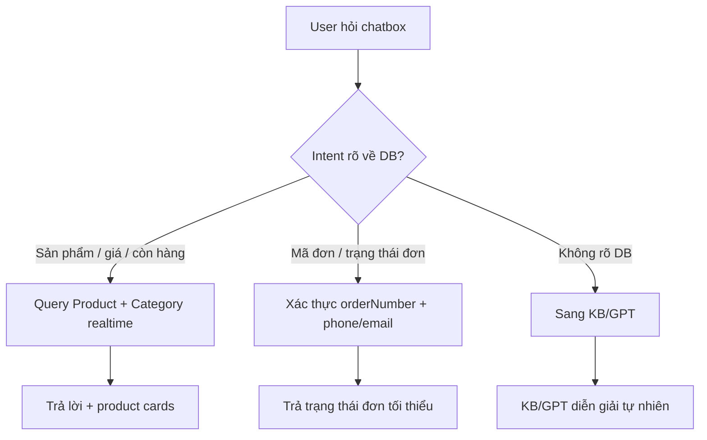

# DB review cho Chatbox Rêu

Mục tiêu của file này: duyệt lại phần DB trước khi đi tiếp sang KB và GPT. DB là nguồn sự thật cho sản phẩm, giá, tồn kho và đơn hàng; admin chỉnh DB xong thì chatbox phải đọc theo DB, không "train" cứng vào GPT.

## 1. DB đang lưu ở đâu

- Schema chính: `apps/web/prisma/schema.prisma`
- Schema mirror/package: `packages/database/prisma/schema.prisma`
- Admin sản phẩm: `/tiem-nho-nth24/products`
- Admin danh mục: `/tiem-nho-nth24/categories`
- Admin đơn hàng: `/tiem-nho-nth24/orders`
- API chatbox: `apps/web/app/api/consult/route.ts`

Khi sửa schema DB, cần giữ hai file schema đồng bộ nếu repo vẫn dùng cả `apps/web/prisma` và `packages/database/prisma`.

## 2. Sản phẩm, giá, tồn kho

### Bảng chính

`Product`

- `name`: tên sản phẩm
- `slug`: URL sản phẩm
- `basePrice`: giá gốc
- `salePrice`: giá khuyến mãi
- `saleEndDate`: hạn flash sale
- `inventory`: tồn kho tổng của sản phẩm
- `status`: `DRAFT`, `ACTIVE`, `OUT_OF_STOCK`
- `featured`: sản phẩm nổi bật
- `pinnedUntil`: ghim sản phẩm
- `categoryId`: danh mục
- `images`: ảnh sản phẩm
- `size`: kích thước bể
- `soil`: loại đất
- `moss`: loại rêu
- `driftwood`: bố cục lũa
- `accessories`: phụ kiện
- `displayRating`, `displayReviewCount`: sao/lượt đánh giá hiển thị

`ProductVariant`

- `variantType`: loại phiên bản
- `value`: giá trị phiên bản
- `priceAdjustment`: giá cộng thêm
- `inventory`: tồn kho theo phiên bản
- `sku`: mã SKU

`CareGuide`

- `watering`: tưới nước
- `sunlight`: ánh sáng
- `temperature`: nhiệt độ
- `humidity`: độ ẩm
- `commonIssues`: vấn đề thường gặp và cách xử lý
- `videoUrl`: video hướng dẫn

### Chatbox hiện đang đọc gì từ DB

Khi câu hỏi là intent sản phẩm, chatbox query realtime từ `Product`:

- Chỉ lấy `status = ACTIVE`
- Chỉ lấy sản phẩm `inventory > 0`
- Lọc giá bằng `salePrice` nếu có, nếu không thì `basePrice`
- Lọc danh mục bằng tên danh mục chứa: `bể`, `cây`, `phụ kiện`, `combo`
- Trả tối đa 6 sản phẩm
- Card đang hiển thị: tên, slug, giá, giá gốc, ảnh đầu tiên, danh mục

Hiện tại chatbox chưa dùng các trường này trong câu trả lời/card sản phẩm:

- `size`
- `soil`
- `moss`
- `driftwood`
- `accessories`
- `CareGuide`
- `ProductVariant.inventory`
- `sku`

### Tự động cập nhật được không?

Có, với các phần chatbox đã nối DB:

- Admin sửa tên, giá, sale, ảnh, tồn kho, trạng thái sản phẩm thì chatbox đọc theo DB ở request kế tiếp.
- Nếu sản phẩm chuyển sang `DRAFT`, `OUT_OF_STOCK` hoặc `inventory = 0`, chatbox sẽ không gợi ý sản phẩm đó.
- Khi khách tạo đơn thành công, hệ thống đã trừ `Product.inventory` trong transaction.
- Không cần redeploy chỉ để cập nhật sản phẩm/giá/tồn kho qua admin.

Lưu ý:

- Catalog đưa vào prompt GPT/Ollama có cache 5 phút, nên phần "ngữ cảnh sản phẩm" cho AI có thể chậm tối đa 5 phút.
- Product cards từ DB intent đang query trực tiếp, không phụ thuộc cache 5 phút.

### Cần duyệt trước

- [ ] Tên sản phẩm đã đúng ngôn ngữ bán hàng chưa?
- [ ] Slug URL đã gọn và không trùng chưa?
- [ ] Giá gốc và giá khuyến mãi đúng chưa?
- [ ] Tồn kho tổng đúng chưa?
- [ ] Sản phẩm nào được bán thì để `ACTIVE`, sản phẩm chưa bán thì để `DRAFT`.
- [ ] Danh mục đã đúng chưa?
- [ ] Ảnh đầu tiên có phải ảnh đại diện tốt nhất chưa?
- [ ] Các trường `size`, `soil`, `moss`, `driftwood`, `accessories` đã đủ để chatbox tư vấn chưa?
- [ ] `CareGuide` từng sản phẩm đã có tưới nước, ánh sáng, vấn đề thường gặp chưa?

### Thiếu nên bổ sung cho chatbox

Để trả lời đúng các câu như "bể nào đã setup", DB nên có thêm trường rõ ràng thay vì đoán theo danh mục/tên:

- `setupStatus`: `READY_TO_DISPLAY`, `DIY_KIT`, `CUSTOM_ORDER`
- `careLevel`: `EASY`, `MEDIUM`, `ADVANCED`
- `chatTags`: danh sách tag như `setup-san`, `de-cham`, `qua-tang`, `ban-lam-viec`, `phong-ngu`, `co-den`
- `shortConsultNote`: ghi chú tư vấn ngắn cho chatbox, ví dụ "phù hợp bàn làm việc, người mới, ít chăm"

Nếu chưa muốn sửa schema ngay, có thể tạm dùng `accessories`/`CareGuide`/tên danh mục, nhưng độ chính xác sẽ thấp hơn.

## 3. Danh mục

### Bảng chính

`Category`

- `name`: tên danh mục
- `slug`: URL danh mục
- `parentId`: danh mục cha
- `status`: `ACTIVE`, `INACTIVE`
- `sortOrder`: thứ tự kéo thả trong admin
- `metaDescription`: mô tả SEO

### Tự động cập nhật được không?

Có:

- Admin kéo thả danh mục thì cập nhật `sortOrder`.
- API danh mục trả theo `sortOrder asc`, sau đó `name asc`.
- Sản phẩm hiển thị theo danh mục mà admin đã gán trong DB.

### Cần duyệt trước

- [ ] Danh mục có đúng nhóm bán hàng thật không?
- [ ] Tên danh mục có chứa từ khóa mà khách hay hỏi không? Ví dụ: "Bể Mini", "Bể Cơ Bản", "Phụ kiện".
- [ ] Thứ tự danh mục đã đúng ưu tiên bán hàng chưa?
- [ ] Danh mục không dùng nữa nên để `INACTIVE`.

## 4. Đơn hàng

### Bảng chính

`Order`

- `orderNumber`: mã đơn
- `customerId`: khách đăng nhập nếu có
- `subtotal`, `shippingFee`, `discount`, `total`: tiền đơn
- `shippingMethod`: `GHN_STANDARD`, `GHN_EXPRESS`, `GRAB`
- `paymentMethod`: `COD`, `MOMO`, `BANK_TRANSFER`
- `paymentStatus`: `PENDING`, `PAID`, `FAILED`, `REFUNDED`
- `status`: `PENDING`, `CONFIRMED`, `PROCESSING`, `SHIPPING`, `SHIPPED`, `DELIVERED`, `CANCELLED`, `REFUNDED`

`OrderItem`

- Lưu snapshot sản phẩm tại lúc đặt: `productName`, `productImage`, `variants`, `quantity`, `price`, `customOptions`
- Không relation ngược về Product để tránh đơn cũ bị đổi khi sản phẩm thay đổi.

`ShippingInfo`

- Tên, phone, email, địa chỉ, tracking number/url.

`OrderStatusLog`

- Ghi lịch sử đổi trạng thái đơn.

### Tự động cập nhật được không?

Có:

- Khi tạo đơn: tự kiểm tra tồn kho và trừ tồn kho trong transaction.
- Khi admin đổi trạng thái đơn: cập nhật `Order.status` và ghi `OrderStatusLog`.
- Khi admin đổi thanh toán: cập nhật `Order.paymentStatus`.

Hiện tại chatbox chưa có flow tra cứu đơn hàng. Nếu muốn bật, nên làm theo hướng an toàn:

- Khách hỏi mã đơn, ví dụ `ORD-...`
- Chatbox yêu cầu thêm số điện thoại hoặc email đã đặt hàng.
- API kiểm tra `orderNumber + phone/email`, chỉ trả thông tin tối thiểu: trạng thái đơn, thanh toán, phương thức giao, tracking nếu có.
- Không gửi địa chỉ đầy đủ hoặc thông tin nhạy cảm nếu chưa xác thực.

### Cần duyệt trước

- [x] Shop muốn khách tra cứu bằng SĐT.
- [x] Các trạng thái đơn phải hiển thị bằng tiếng Việt.
- [x] Có cho chatbox trả tracking link không? Không.
- [x] Có cho chatbox nói tổng tiền đơn không? Không.
- [x] Có cần ẩn địa chỉ/số điện thoại trong chatbox không? Có.

Quy tắc đã chốt:

- Chatbox cho phép khách tra cứu đơn hàng bằng SĐT.
- Chatbox chỉ trả thông tin tối thiểu: mã đơn, trạng thái đơn tiếng Việt, trạng thái thanh toán tiếng Việt, ngày đặt, danh sách sản phẩm rút gọn.
- Không trả tracking link.
- Không trả tổng tiền đơn.
- Không trả địa chỉ, SĐT, email hoặc thông tin giao hàng chi tiết.
- Nếu không tìm thấy đơn theo SĐT, hướng dẫn khách kiểm tra lại SĐT hoặc liên hệ shop.

## 5. Luồng DB mong muốn cho chatbox

## 6. Việc nên làm tiếp theo ở phần DB

Ưu tiên 1: Duyệt dữ liệu hiện có trong admin.

- [ ] Duyệt danh mục và thứ tự danh mục.
- [ ] Duyệt từng sản phẩm ACTIVE: tên, giá, sale, tồn kho, danh mục, ảnh.
- [ ] Bổ sung trường tư vấn đang trống: size, soil, moss, driftwood, accessories.
- [ ] Bổ sung CareGuide cho sản phẩm chính.

Ưu tiên 2: Nâng schema để chatbox hiểu đúng sản phẩm.

- [x] Thêm `setupStatus` cho Product.
- [x] Thêm `careLevel` cho Product.
- [x] Thêm `chatTags` cho Product.
- [x] Thêm `shortConsultNote` cho Product.
- [x] Hiển thị các trường này trong admin tạo/sửa sản phẩm.
- [x] Cho chatbox query và trả lời theo các trường này.

Ưu tiên 3: Nối đơn hàng vào chatbox.

- [x] Thêm intent phát hiện câu hỏi tra cứu đơn.
- [x] Tra cứu đơn bằng SĐT theo quyết định đã chốt.
- [x] Trả trạng thái đơn bằng tiếng Việt.
- [x] Không trả tracking link.
- [x] Không trả tổng tiền đơn.
- [x] Không đưa địa chỉ, SĐT, email hoặc thông tin nhạy cảm vào chatbox.

## 7. Quy tắc sau khi DB đã chuẩn

- DB trả lời câu hỏi về sản phẩm, giá, tồn kho, đơn hàng.
- KB trả lời chính sách, chăm sóc, xử lý sự cố, quy tắc shop.
- GPT chỉ dùng để hiểu câu hỏi khó, nối ngữ cảnh, diễn giải tự nhiên; không tự bịa giá, tồn kho, trạng thái đơn.
